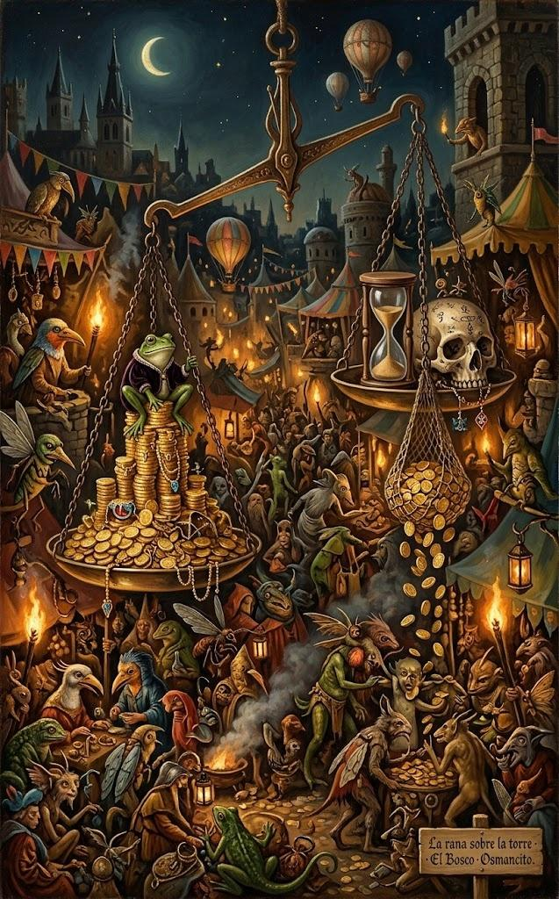

28 de octubre de 2026

# PEPE: visión de mercado

PEPE es la moneda de un meme que no promete nada, y en los últimos días el mercado volvió a mirarla: subió con fuerza mientras una firma de análisis atribuía una posición gigante a un nombre conocido. Esta es la primera prueba del protocolo Investigación de Activos: una visión estructurada de PEPE reunida de fuentes públicas esa misma tarde. Cada afirmación lleva su fuente y lo no comprobado se declara.

## 1. El activo y su contexto

PEPE es un **token**, un activo digital registrado en una cadena de bloques, el registro público de operaciones que ninguna parte controla sola. Es de tipo **memecoin**: un token basado en un meme, la rana Pepe del dibujante Matt Furie. Vive dentro de la cadena de bloques Ethereum como un token ERC-20, de la norma que Ethereum fija para los tokens intercambiables, y su contrato es visible en Etherscan.

Se lanzó en abril de 2023. Según CoinMarketCap y Blockworks, la propiedad del contrato quedó renunciada en el lanzamiento y el contrato no puede crear monedas nuevas: el suministro es fijo en 420,69 billones de unidades (billón en castellano: un millón de millones). En octubre de 2023 el equipo quemó 6,9 billones, es decir, los envió a una dirección de la que no se pueden recuperar.

El proyecto no declara producto ni utilidad: el contrato solo permite transferir tokens, sin premios por guardarlos ni comisiones propias al moverlos (en Ethereum sí se paga el gas, la comisión de la red), y, según Blockworks, no genera ingresos ni rendimiento. Su valor depende por completo de que alguien quiera comprarlo después.

En el frente regulatorio, la gestora Canary Capital pidió ante la SEC, el regulador de valores de Estados Unidos, registrar un fondo cotizado al contado de PEPE: un fondo que cotizaría en bolsa y guardaría el token directamente. Presentó la solicitud en abril y una enmienda a comienzos de octubre. Una solicitud en trámite no es una aprobación. CoinMarketCap estima que el plazo de revisión terminaría hacia inicios de diciembre; es una estimación de esa fuente, no una fecha oficial del documento.

## 2. El comportamiento del precio

Al momento de la consulta, PEPE rondaba las 4,8 millonésimas de dólar y subía ese día entre un 8% y un 17%, según la fuente. En la semana acumulaba cerca de un 15%, en el mes un 16% y en el año un 33%. Su valor de mercado rondaba los 2.000 millones de dólares, el puesto 49 entre las criptomonedas. Las cifras exactas de cada fuente están al final.

Según CoinMarketCap, del 17 al 22 de octubre PEPE subió cerca de un 13% mientras Bitcoin se movía poco, en torno a los 80.000 dólares, dentro de una rotación de capital hacia activos de mayor riesgo en la que PEPE destacó entre las memecoins. La fuente lo presenta como el contexto de la subida, no como una causa demostrada. El precio llegó a superar brevemente las 5 millonésimas de dólar y después retrocedió hasta la zona de su media móvil de 9 días, el promedio de los últimos 9 días.

El análisis técnico de FXStreet señala los niveles de la zona: la siguiente resistencia un poco por encima de ese máximo, el soporte en la media de 50 días un poco por debajo del retroceso, y el RSI, el índice de fuerza relativa que marca 70 como zona de subida excesiva, en 64.

## 3. La actividad registrada

Los registros públicos de la cadena muestran movimientos grandes en las últimas dos semanas:

- El 16 de octubre salieron de las casas de cambio casi 5 billones de monedas, unos 20 millones de dólares: una reducción del 6% de lo que las casas de cambio guardaban, en un solo día, con 15 transferencias de más de un millón de dólares y salidas ocho veces mayores que el promedio de los días previos (fuente: Santiment, vía Altcoins Analysis).
- Arkham Intelligence, una empresa de análisis de la cadena, atribuyó al fundador de Tron, Justin Sun, carteras con casi 12 billones de monedas: unos 51 millones de dólares, cerca del 2,8% del suministro, acumulados en dos retiros de la casa de cambio Poloniex los días 17 y 26. Según esa atribución sería la mayor posición individual fuera de las casas de cambio, y al momento de la consulta no se había vendido. Arkham aclara que la atribución sale de su metodología y no es una propiedad confirmada (fuentes: Arkham, vía CoinCentral, ICOBench y FXStreet).
- En la distribución por direcciones, Binance guarda cerca del 19% del suministro y Robinhood algo más del 8% (fuente: Arkham, vía CoinCentral). La solicitud de Canary indica que las diez direcciones más grandes reunían poco más del 40% del suministro circulante en enero. Las direcciones no equivalen a personas: las casas de cambio custodian en pocas direcciones las monedas de muchos clientes, así que estos datos no demuestran cuántos propietarios reales concentran el suministro hoy.
- En los derivados, las apuestas sobre el precio sin comprar el token, el interés abierto en futuros equivalía a casi la mitad del valor de mercado y el volumen de futuros fue unas 22 veces el de compraventa directa (fuente: CoinGecko). Son indicadores de una actividad especulativa intensa; no miden directamente el apalancamiento de las posiciones.

## 4. El sentimiento del mercado

El ánimo reciente es alcista y va acompañado de mucha atención:

- La dominancia social de PEPE, la parte de la conversación cripto que habla de él según Santiment, subió a 1,2%, su nivel más alto desde mediados de abril (fuente: FXStreet).
- Las tasas de financiación de los futuros, el pago periódico entre quienes apuestan al alza y a la baja, se volvieron apenas positivas, y las apuestas al alza superaban por poco a las de la baja. El volumen de futuros creció más de un 70% (fuentes: CoinGlass, vía FXStreet; CoinMarketCap).
- FXStreet y CoinMarketCap señalaron la revelación de la posición atribuida a Justin Sun como el detonante probable de la atención compradora del día. Es la lectura de esas fuentes, no un hecho demostrado.
- Hay voces divididas: algunos analistas proyectan más subida por patrones técnicos; otros recuerdan que la solicitud del fondo cotizado no movió el precio cuando se presentó y que la ruptura solo se confirmaría con un cierre semanal por encima de las 5,8 millonésimas de dólar (fuente: CoinMarketCap).

## 5. Las señales de riesgo

- **Concentración en pocas direcciones:** el registro muestra el suministro reunido en muy pocas manos visibles. Aun con la salvedad sobre direcciones y personas, una venta grande desde una posición como la atribuida a Justin Sun podría presionar el precio a la baja (fuente: CoinMarketCap).
- **Sin utilidad declarada:** el proyecto no declara producto ni genera ingresos; su valor depende de la demanda de quienes lo compran y venden.
- **Liquidez concentrada:** alrededor de la mitad del volumen se negocia en Binance y OKX, según Blockworks; perder uno de esos mercados reduciría mucho la profundidad del mercado.
- **Especulación intensa en derivados:** con la actividad de futuros descrita, una caída brusca podría forzar cierres automáticos de apuestas, las liquidaciones, que amplificarían el movimiento. Es una posibilidad del mecanismo, no una predicción.
- **Historial del proyecto:** en agosto de 2023 hubo un robo del monedero multifirma del equipo, el que exige varias firmas para mover fondos; la quema de monedas del primer apartado vino después de ese robo (fuente: Blockworks). En diciembre de 2025, la firma Bubblemaps afirmó que cerca del 30% del suministro inicial estuvo en manos de una misma entidad, que vendió 2 millones de dólares al día siguiente del lanzamiento, poniendo en duda la narrativa del lanzamiento justo; ese mismo mes el sitio web de Pepe fue vulnerado y redirigía a una herramienta de robo de carteras (fuente: CoinTelegraph). Son afirmaciones de esas fuentes, no comprobaciones propias.
- **Riesgo regulatorio de dos salidas:** la decisión de la SEC sobre el fondo cotizado puede impulsar el precio o enfriarlo.
- **Dependencia del mercado general:** la subida reciente ocurrió durante una rotación hacia activos de riesgo; según CoinMarketCap, una caída fuerte de Bitcoin podría revertirla rápido.

## 6. La conclusión estructurada

**Lo reunido muestra un token que sube con atención especulativa intensa sobre una base frágil: concentración en pocas direcciones, sin utilidad declarada y mucha actividad en derivados. Las mismas condiciones que acompañan una subida rápida pueden acompañar una caída rápida.**

**Comprobado en fuentes abiertas:**

- La identidad del token: es el PEPE de Ethereum de la rana Pepe, con contrato visible en Etherscan.
- La solicitud del fondo cotizado existe: el formulario de Canary Capital consta en la SEC.
- Las cifras de precio, volumen, distribución y derivados aquí citadas, tal como las publicaron las fuentes señaladas.

**Reportado por fuentes, sin comprobación propia:**

- La atribución de las carteras a Justin Sun, que sale de la metodología de Arkham, y los datos de Santiment, CoinGlass y Bubblemaps.
- La lectura de que esa revelación detonó la subida, y de que hubo una rotación hacia activos de riesgo.

**No comprobado:**

- Que los retiros de las casas de cambio hayan causado la subida: la fuente misma aclara que no lo demuestra.
- Que la subida continúe o que la SEC apruebe el fondo: nadie lo sabe.

## 7. Datos y fuentes

La prosa usa cifras de lectura redondeadas. Los datos siguientes conservan la precisión de cada fuente para quien quiera comprobar o calcular.

Consultar cifras exactas y notas de los datos

| Dato | Valor publicado |
| --- | --- |
| Contrato del token | `0x6982508145454Ce325dDbE47a25d4ec3d2311933` (Etherscan) |
| Precio al consultar | $0,00000483 (CoinGecko); $0,00000498 (CoinMarketCap) |
| Cambio en 24 horas | +7,8% a +10,1% (CoinGecko, texto y tabla de métricas); +16,7% (CoinMarketCap) |
| Rango de 24 horas | $0,00000445 a $0,00000503 (CoinGecko al consultar) |
| Semana | +15% aprox. (FXStreet) |
| 30 días | +16,3% (CoinGecko) |
| Un año | +32,8% (CoinGecko) |
| Valor de mercado | ≈ $2.030 millones, puesto 49 (CoinGecko) |
| Máximo breve y retroceso | superó $0,00000500; retrocedió a $0,00000435, la media móvil de 9 días (CoinMarketCap) |
| Resistencia y soporte (FXStreet) | $0,00000521; $0,00000412 (media de 50 días); RSI 64 |
| Salidas del 16 de octubre | 4,77 billones de PEPE (≈ $20 millones); −6% del suministro en casas de cambio; 15 transferencias de más de $1 millón (Santiment, vía Altcoins Analysis) |
| Posición atribuida a Justin Sun | 11,92 billones de PEPE (≈ $51,25 millones; 2,83% del suministro), en retiros de Poloniex del 17 y el 26 de octubre (Arkham) |
| Custodia por direcciones | Binance 18,7%; Robinhood 8,37%; las diez mayores, 41% del circulante en enero de 2026 (Arkham; solicitud de Canary) |
| Derivados | interés abierto en futuros: 46,9% del valor de mercado; volumen de futuros: 21,8 veces el directo (CoinGecko) |
| Dominancia social | 1,209% (Santiment, vía FXStreet) |
| Financiación de futuros | 0,013%; relación al alza frente a la baja: 1,06 (CoinGlass, vía FXStreet); volumen de futuros +72,7% (CoinMarketCap) |
| Cierre semanal de confirmación | por encima de $0,00000578 (CoinMarketCap) |
| Solicitud del fondo cotizado | formulario S-1 del 8 de abril de 2026; enmienda S-1/A del 2 de octubre de 2026 (SEC) |

Las fuentes se consultaron hacia la 1:00 p.m. y las cifras de precio se tomaron minutos después. Las horas se expresan en UTC-4. Las cotizaciones agregadas son referencias, no ofertas de compraventa, y cada proveedor las redondea y las actualiza a su manera: de ahí las diferencias entre fuentes.

Esta visión reúne información: no recomienda comprar ni vender, no promete ganancias y no predice precios.

- Precio, valor de mercado, volumen y derivados: [CoinGecko, ficha de PEPE](https://www.coingecko.com/en/coins/pepe).
- Noticias del día y análisis: [CoinMarketCap (CMC AI), actualizaciones de PEPE](https://coinmarketcap.com/cmc-ai/pepe/latest-updates/).
- Sentimiento, derivados y niveles técnicos: [FXStreet, «PEPE climbs as Justin Sun stake fuels rally»](https://www.fxstreet.com/cryptocurrencies/news/pepe-price-forecast-pepe-climbs-as-justin-sun-linked-wallets-spark-bullish-sentiment-202610280541), publicado el 28 de octubre de 2026.
- Salidas de exchanges del 16 de octubre: [Santiment, vía Altcoins Analysis](https://altcoinsanalysis.com/pepe-rises-with-4-77-trillion-coins-leave-exchanges-before-october-rally/), publicado el 23 de octubre de 2026.
- Posición atribuida a Justin Sun: Arkham Intelligence, vía [CoinCentral](https://coincentral.com/pepe-price-rises-as-justin-sun-linked-wallets-hold-nearly-3-of-supply/) e [ICOBench](https://icobench.com/news/pepe-crypto-justin-sun-top-holder/), publicado el 28 de octubre de 2026.
- Suministro, utilidad, concentración e historial: [Blockworks Intel, divulgaciones de PEPE](https://app.blockworks.com/projects/pepe/disclosures); [CoinTelegraph, análisis de Bubblemaps](https://cointelegraph.com/news/pepe-memecoin-launch-insider-wallet-concentration-bubblemaps), publicado en diciembre de 2025.
- Contrato del token: [Etherscan, 0x6982508145454Ce325dDbE47a25d4ec3d2311933](https://etherscan.io/address/0x6982508145454Ce325dDbE47a25d4ec3d2311933).
- Solicitud de fondo cotizado: [formulario S-1/A de Canary Capital ante la SEC, 2 de octubre de 2026](https://www.sec.gov/Archives/edgar/data/2109686/000199937126022017/canarypepe-s1a_100226.htm).

---

© 2026 Osmancito
