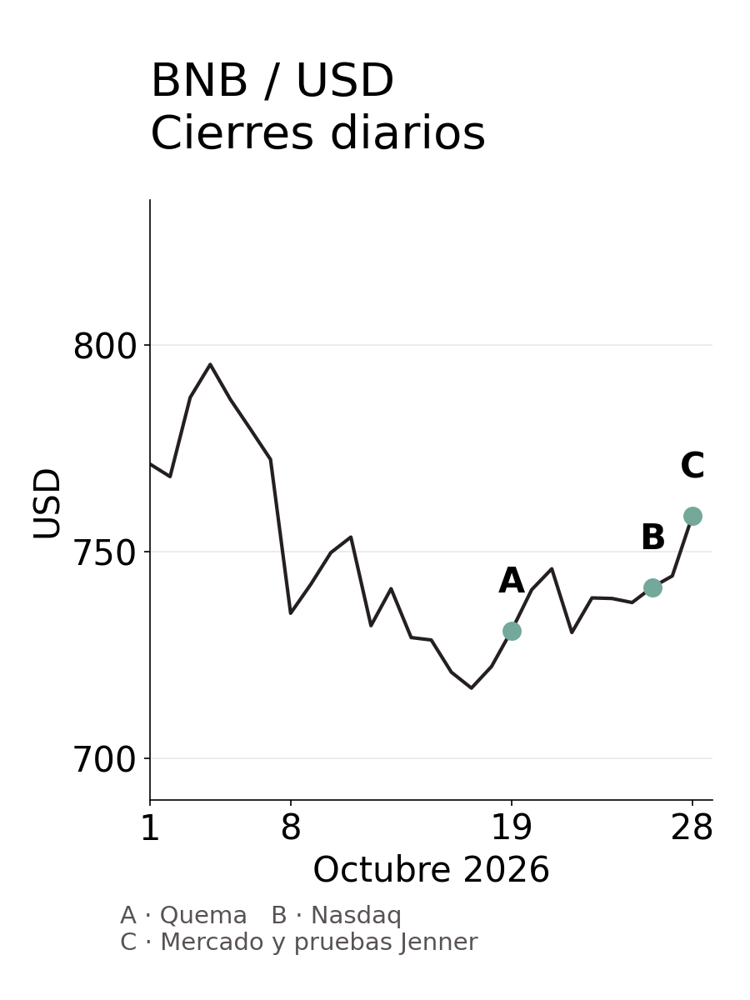

29 de octubre de 2026

# BNB: precio y acontecimientos

Octubre reúne tres historias alrededor de BNB: una quema de monedas, una ceremonia en Nasdaq y una actualización de la red. La gráfica permite situarlas junto al precio y leerlas en el contexto del mercado. Las fuentes y cotizaciones de este artículo se consultaron esta mañana.

## 1. El activo y su contexto

BNB es la moneda usada para pagar operaciones en BNB Chain, una red que registra transacciones y ejecuta programas. También tiene usos dentro de Binance, como descuentos en comisiones. Moneda, red y empresa están relacionadas, pero no son lo mismo: tener BNB no equivale a tener una acción de Binance ni da derecho por sí solo a sus beneficios.

Su precio depende de lo que los participantes estén dispuestos a pagar por esos usos y por sus expectativas. La cuestión útil es si lo que anuncia el proyecto termina generando uso y demanda por la moneda.

## 2. El comportamiento del precio

La gráfica une los cierres diarios publicados por Yahoo Finance. Las letras señalan los acontecimientos que se cuentan a continuación; por sí sola, su coincidencia con un movimiento del precio no establece una causa. La lectura parcial de hoy queda fuera de la gráfica.

| Fecha | Cierre (USD) |
| --- | --- |
| 4 de octubre | 795,26 |
| 7 de octubre | 772,30 |
| 8 de octubre | 735,13 |
| 19 de octubre | 730,96 |
| 28 de octubre | 758,67 |

Del 7 al 8, el precio cayó cerca del 5%, sin un motivo específico comprobado. Desde el cierre del 19 hasta el de ayer recuperó casi un 4%.

Esta mañana rondaba los 740 dólares, algo más de un 2% por debajo del cierre anterior. Es una cotización parcial, no el cierre de hoy. Los datos exactos para calcular están al final.

### A. 19 de octubre: la quema de monedas

La BNB Foundation anunció la retirada definitiva de unos 1,6 millones de monedas, valoradas entonces en unos 1200 millones de dólares. Quedaron alrededor de 130 millones de BNB. El programa calcula las retiradas periódicas con el precio y los bloques producidos, con el objetivo de reducir gradualmente la oferta a 100 millones.

La cifra en dólares expresa el valor de las monedas retiradas, no dinero nuevo que haya entrado al mercado. La quema reduce la oferta; la respuesta del precio depende también de la demanda y de cuánto se hubiera anticipado el anuncio.

### B. 26 de octubre: una campana en Nasdaq

The Block cubrió la ceremonia de BNB Standard, una empresa que mantiene BNB en su tesorería, en Nasdaq. También recogió declaraciones de Changpeng Zhao, fundador de Binance, sobre pagos e inteligencia artificial.

Es una historia de visibilidad institucional y proyectos futuros. La empresa declaraba unas 520 mil monedas al cierre de julio, la misma cantidad que al cierre de abril: esas cifras no documentan una compra nueva durante la ceremonia. Zhao habló de convertir BNB Chain en una red principal para inteligencia artificial, una aspiración que todavía estaba por realizarse.

### C. 28 y 29 de octubre: dos escalas distintas

En la escala del mercado, CoinDesk documentó un rebote general ayer, con BNB cerca de 760 dólares. Hoy registró debilidad de las criptomonedas junto a caídas de tecnológicas y cautela tras la decisión de la Reserva Federal estadounidense de mantener las tasas.

En la escala del proyecto, Jenner, la siguiente actualización de la red, llegó a la red de pruebas, donde se ensayan los cambios antes de usarlos en la red principal. Las notas de versión fijaban la activación para anoche y CoinCentral informó hoy que ya estaba activa. La fecha de paso a la red principal seguía sin confirmarse.

Una de sus funciones reserva el 5% de la capacidad de procesamiento de cada bloque para pagos elegibles: es como reservar un carril para cierta clase de tráfico, sin hacer gratis las operaciones ni garantizar la inclusión de cada pago. También incorpora la base para un nuevo formato de monedas con controles de transferencias, cuya disponibilidad requiere pasos separados.

Son nuevas capacidades técnicas. Su efecto económico dependerá del uso que reciban.

## 3. La actividad registrada

La fotografía del tercer trimestre es mixta. Según TokenPost y CryptoBriefing, la red procesó unos 1500 millones de transacciones, un 7,5% más que en el trimestre anterior. Los ingresos de red rondaron los 54 millones de dólares, un 54% más, mientras las direcciones activas diarias bajaron un 14%, hasta unos 2,1 millones. CryptoBriefing atribuye las cifras al informe trimestral de Blockworks.

Una dirección es un identificador que puede recibir o mover monedas. Una persona o un programa puede usar varias, de modo que más transacciones con menos direcciones puede reflejar actividad más intensa, no un mayor número de personas. Los ingresos de red tampoco son dividendos que se reciban automáticamente por guardar BNB.

## 4. El sentimiento del mercado

El ánimo está dividido. CoinCentral recoge una lectura alcista de un analista sobre la gráfica. CoinDesk, en cambio, registró hoy una inclinación bajista en los contratos de BNB sin vencimiento: la financiación pasó a negativa, de modo que quienes apostaban a la baja pagaban a quienes apostaban al alza. Esta señal describe esos contratos, no al conjunto de quienes poseen la moneda.

## 5. Las señales de riesgo

BNB combina la volatilidad del mercado con las dudas sobre cuánto uso conseguirán sus nuevas funciones. La documentación describe 45 validadores activos y la selección de 21 productores de bloques por período. Son operadores que verifican y agrupan transacciones: la distribución del control entre ellos importa para entender la concentración operativa de la red.

La investigación no auditó quién controla esos validadores ni la concentración de monedas por propietario. Tampoco midió los movimientos actuales de grandes carteras o las compras netas recientes de instituciones. Esas son las piezas que faltan para completar el panorama del control y los flujos de dinero.

## 6. La conclusión

BNB tiene menos monedas tras la quema, nuevas funciones en pruebas y una red con más operaciones trimestrales, pero menos direcciones activas. Al mismo tiempo, su precio se mueve dentro de un mercado que pasó del rebote a la debilidad.

La pregunta que queda abierta es concreta: ¿las capacidades anunciadas se convierten en uso sostenido y demanda por BNB, o el precio acompaña sobre todo al mercado? Para distinguirlo hacen falta datos de uso y flujos comparables en el tiempo, no solo titulares favorables.

## 7. Datos y fuentes

La prosa usa cifras redondeadas. La tabla de cierres y los datos siguientes conservan la precisión para quien quiera hacer cálculos.

Consultar cifras exactas y notas de los datos

| Dato | Valor publicado |
| --- | --- |
| BNB retirados en la quema | 1.646.196,44 BNB |
| Valor aproximado de la quema | 1.197.344.519,40 USD |
| Oferta restante tras la quema | 131.512.085 BNB |
| BNB de BNB Standard al cierre de julio | 515.544 BNB, igual que al cierre de abril |
| Transacciones del tercer trimestre | 1.510 millones; +7,5% trimestral |
| Ingresos de red del tercer trimestre | 54,2 millones USD; +54% trimestral |
| Direcciones activas diarias del tercer trimestre | 2,10 millones; −14% trimestral |
| Caída entre los cierres del 7 y el 8 | −4,81% |
| Recuperación entre los cierres del 19 y el 28 | +3,79% |
| Cotización parcial del 29 | 742,17 USD; −2,17% frente al cierre del 28 |

La consulta original terminó hacia las diez de la mañana; la cotización parcial corresponde a las 9:49. Las horas se expresan en UTC-4. Los porcentajes de precio se calculan frente a los cierres indicados, no frente a las bases de otros encabezados del proveedor. Los días de la serie son los de Yahoo Finance, no cierres de medianoche de esta zona horaria, y las cotizaciones agregadas son referencias, no ofertas de compraventa.

Para Jenner, la guía general menciona el día 28 y las notas de versión fijan la activación en pruebas para el 29 a las 02:30 UTC, equivalente a la noche anterior en la zona indicada. Ambas se refieren a la red de pruebas.

Las fuentes del proyecto describen sus anuncios y mecanismos; la cobertura independiente aporta contraste. Este artículo reúne información, no una recomendación de compra o venta.

- [BNB Chain, funciones de BNB](https://www.bnbchain.org/en/what-is-bnb)
- [Yahoo Finance, historial BNB-USD](https://finance.yahoo.com/quote/BNB-USD/history/)
- [BNB Foundation, quema del 19 de octubre](https://www.bnbchain.org/en/blog/37th-bnb-burn)
- [BNB Chain, notas de versión Jenner](https://www.bnbchain.org/en/releases)
- [BNB Chain, guía de Jenner](https://www.bnbchain.org/en/blog/jenner-hardfork-changes-upgrade-guide)
- [CoinDesk, mercado del 28 de octubre](https://www.coindesk.com/business/2026/10/28/live-updates-bitcoin-climbs-above-usd81-000-as-majors-rally-ahead-of-fed-decision)
- [CoinDesk, mercado del 29 de octubre](https://www.coindesk.com/markets/2026/10/29/bitcoin-drops-to-usd80-000-on-fed-dissent-samsung-alphabet-earnings-ai-tokens-slump)
- [TokenPost, actividad del tercer trimestre](https://www.tokenpost.com/news/investing/39433)
- [CryptoBriefing, lectura del informe de Blockworks](https://cryptobriefing.com/bnb-chain-q3-transactions-tokenized-equities/)
- [The Block, BNB Standard, pagos e IA](https://www.theblock.co/news/ecosystems/2026-10-26-cz-pitches-bnb-chains-role-ai-bnb-standard-rings-nasdaq-bell-431790)
- [BNB Standard, tesorería y capital](https://www.bnbstandard.com/investors/treasury-capital)
- [BNB Chain, validadores](https://docs.bnbchain.org/bnb-smart-chain/validator/overview/)
- [CoinCentral, análisis y anuncio de pruebas](https://coincentral.com/bnb-price-holds-above-750-as-jenner-upgrade-goes-live-on-testnet/)
- [Edge, antecedente sobre derechos del tenedor (2022)](https://edge.app/blog/company-news/edge-adds-support-for-bnb/)

---

© 2026 Osmancito
