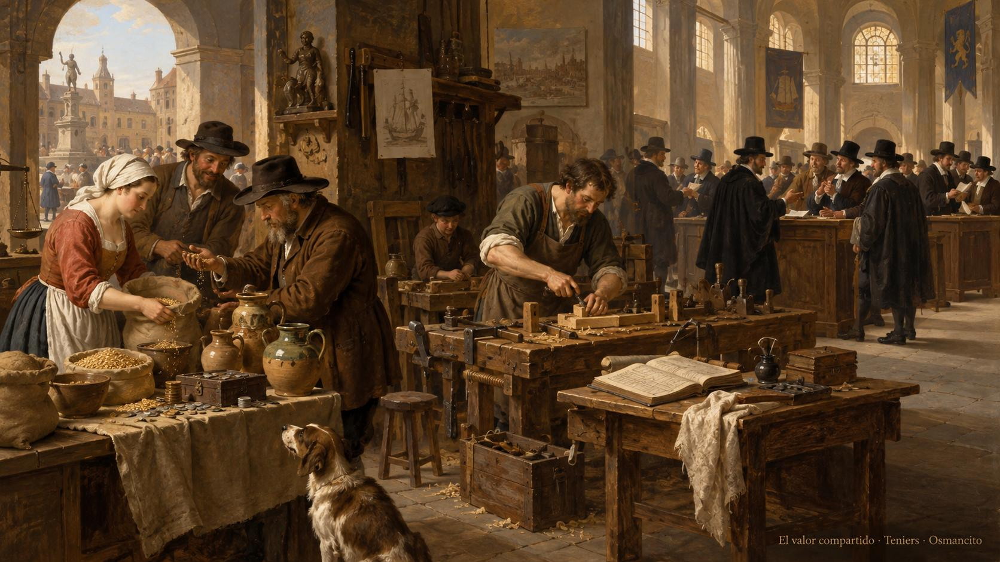

29 de octubre de 2026

# Del intercambio a la bolsa

*El hilo del dinero · Primera entrega*

En una bolsa de valores se negocian participaciones en empresas. Detrás de una pantalla de precios hay negocios, personas que aportan dinero y otras que desean recuperar lo que aportaron. Antes de leer esas pantallas conviene entender qué se intercambia y qué recibe quien compra.

Este recorrido empieza antes de los corredores y los edificios de Nueva York: en la diferencia entre un objeto, el dinero con que se paga y el derecho que se adquiere. No hace falta saber de economía para seguirlo.

## 1. Antes de las monedas

Una persona tiene grano y otra fabrica vasijas. Si entregan una cantidad de grano a cambio de una vasija, hacen un **trueque**, un intercambio directo de bienes. Es un ejemplo que ayuda a plantear una dificultad: ambas deben querer lo que ofrece la otra y acordar cuánto vale.

El ejemplo no cuenta por sí solo cómo nació el dinero. No hay que imaginar a toda la humanidad recorriendo una fila única de etapas, primero trueque, luego monedas y después bancos. La historia conserva formas diferentes de intercambiar, prestar, pagar y llevar cuentas. El [Museo Británico](https://www.britishmuseum.org/collection/galleries/money) recuerda que ciudades e imperios comerciaron sin monedas durante más de dos milenios.

El [Banco de Inglaterra](https://www.bankofengland.co.uk/explainers/what-is-money) recoge otro caso: en el antiguo Egipto se depositaba grano en almacenes y se transferían cantidades entre cuentas para saldar deudas. Una **deuda** es una obligación de entregar algo a otra persona. Llevar una cuenta permite recordar quién entregó, quién recibió y qué queda por pagar, aunque no haya una moneda en cada operación.

La prehistoria no ofrece un acta de nacimiento del dinero. Lo que puede seguirse con fuentes son prácticas y objetos concretos. Hubo conchas utilizadas como dinero, metales valorados por su peso y, más tarde, monedas y billetes. La moneda acuñada, una pieza de metal fabricada con un peso y unas marcas, es una forma de dinero; no es la definición de todo el dinero.

## 2. Para qué sirve el dinero

El **dinero** es un medio aceptado para pagar que también permite expresar precios y conservar valor para usarlo después. Son tres funciones relacionadas. Un precio indica cuánto dinero se pide por algo. Pagar permite obtenerlo sin entregar a cambio otro bien que el vendedor necesite. Guardar dinero permite separar el momento en que se recibe del momento en que se gasta.

Un caso sencillo reúne las tres funciones. Una persona cobra por reparar una silla, compara el precio del pan con el de otros alimentos y reserva parte de lo cobrado para la semana siguiente. No necesita encontrar un panadero que quiera una silla reparada en ese preciso momento.

Conservar dinero no garantiza conservar la misma capacidad de compra. Si suben los precios de los bienes y servicios, una misma cantidad alcanza para menos. Ese aumento general de precios se llama **inflación**. El [Banco de Inglaterra](https://www.bankofengland.co.uk/explainers/what-is-money) explica las funciones del dinero; [Investor.gov](https://www.investor.gov/introduction-investing/investing-basics/what-risk), el portal educativo del regulador estadounidense del mercado de valores, explica la pérdida de capacidad de compra.

El dinero tampoco necesita tener valor por el material del que está hecho. Un billete no compra por el precio de su papel. Y el saldo de una cuenta bancaria es un registro, no un montón de billetes situado dentro del teléfono. El Banco de Inglaterra describe el efectivo y los depósitos bancarios como formas del dinero actual. Un pago electrónico no es, por ese solo hecho, una inversión.

## 3. Guardar dinero y ponerlo a trabajar

**Ahorrar** es reservar una parte de lo que se recibe en lugar de gastarla. **Invertir** es destinar recursos a algo con la expectativa de obtener un beneficio futuro. Una persona puede ahorrar para después invertir; las dos palabras no designan la misma decisión.

Comprar una máquina para producir más pan es una inversión del negocio. Comprar una participación en ese negocio es una inversión de quien aporta su dinero. En ambos casos hay una expectativa, no un resultado ya conseguido.

El **riesgo** es la posibilidad de que el resultado sea distinto del esperado y se pierda dinero. Incluye preguntas concretas: ¿funcionará el negocio?, ¿hará falta el dinero antes de lo previsto?, ¿habrá alguien dispuesto a comprar la participación cuando se quiera vender? [Investor.gov](https://www.investor.gov/introduction-investing/investing-basics/what-risk) distingue el riesgo del negocio, los cambios de precio y la dificultad de vender.

Una inversión no se vuelve segura porque aparezca en una aplicación conocida o porque su precio haya subido. Y dejar el dinero sin invertir tampoco elimina todos los riesgos: la inflación puede reducir su capacidad de compra. Son decisiones diferentes, cada una con sus condiciones.

## 4. Una empresa necesita recursos

Una **empresa** organiza recursos y trabajo para producir bienes o prestar servicios. Para abrir una panadería hacen falta, por ejemplo, un local, un horno, ingredientes y personas que trabajen. El dinero permite pagar esos recursos antes de que la venta de pan los reponga.

Si sus propietarios no pueden aportar todo, la empresa puede buscar dinero de otras personas. Hay dos relaciones básicas que conviene distinguir. Puede pedir un préstamo y asumir la obligación de devolverlo según unas condiciones. O puede admitir nuevos propietarios que aporten dinero a cambio de una parte de la empresa. Deber dinero y compartir la propiedad no son lo mismo.

Una **acción** es una participación en la propiedad de una empresa. Quien la posee es un **accionista**. La empresa puede emitir acciones, es decir, crearlas y ofrecerlas, para conseguir dinero con el que ampliar instalaciones o desarrollar productos. La [guía de acciones de Investor.gov](https://www.investor.gov/introduction-investing/investing-basics/investment-products/stocks) describe esa relación.

### Un ejemplo con una panadería imaginaria

Supóngase que una empresa divide su propiedad en cien acciones iguales. Quien tenga diez posee una décima parte, siempre que no existan otras clases de acciones ni cambie la cantidad total. Es un ejemplo de proporciones, no una valoración real de una panadería.

Esa participación no da permiso para llevarse una décima parte del horno o de la caja. Da los derechos que correspondan a esa clase de acción: pueden incluir votar ciertas decisiones y recibir parte de los beneficios cuando se acuerda repartirlos.

Ese reparto se llama **dividendo**. No es un interés fijo que la empresa deba pagar siempre. Hay empresas que no reparten dividendos y destinan sus beneficios a continuar o ampliar el negocio. Además, no todas las acciones conceden los mismos derechos. La guía citada distingue acciones comunes y preferentes; para empezar basta retener que comprar una acción es adquirir una participación con condiciones, no una promesa de ganancia.

## 5. Cuando una participación cambia de dueño

Una persona puede querer invertir en una empresa y otra, que ya es accionista, puede querer recuperar su dinero. Si acuerdan una compraventa, la acción cambia de dueño y el vendedor recibe el pago. La empresa sigue existiendo; lo que cambió fue uno de sus propietarios.

Un **mercado** es el conjunto de intercambios entre quienes compran y venden. Aquí nace una distinción esencial. En el **mercado primario**, las acciones nuevas se venden al ser emitidas y el dinero va al emisor. En el **mercado secundario**, se negocian participaciones que ya existen y el dinero de la compra va al vendedor. Las definiciones de [mercado primario](https://www.investor.gov/introduction-investing/investing-basics/glossary/primary-market) y [mercado secundario](https://www.investor.gov/introduction-investing/investing-basics/glossary/secondary-market) de Investor.gov separan ambas operaciones.

Por tanto, una compra de acciones no siempre entrega dinero nuevo a la empresa. Puede entregar dinero a otro inversor. La posibilidad de vender después facilita que haya personas dispuestas a comprar antes, pero son momentos distintos.

Una **bolsa de valores** es un mercado organizado, con reglas, donde se negocian instrumentos como las acciones. Un **valor**, en este contexto financiero, es un instrumento que incorpora derechos económicos, como una participación en una empresa. La bolsa reúne órdenes de compradores y vendedores; no es la empresa cuyas acciones se compran ni una caja que garantiza beneficios.

## 6. Los corredores de Nueva York

La Bolsa de Nueva York remonta sus orígenes a un acuerdo firmado por dos docenas de corredores en 1792. El acuerdo establecía reglas para negociar y cobrar comisiones. Así lo cuenta la [historia publicada por la propia bolsa](https://www.nyse.com/history-of-nyse). No fue el comienzo de todos los mercados del mundo, sino un episodio concreto en la organización del mercado neoyorquino.

Un **corredor de bolsa** es un intermediario que tramita compras y ventas para sus clientes. Por ese servicio puede cobrar una **comisión**, el precio de realizar la operación. El salón lleno de corredores, puestos de negociación y campanas fue una forma visible de reunir las órdenes y comunicar precios.

La función importa más que la escena. El comprador desea adquirir unas acciones bajo ciertas condiciones; el vendedor desea desprenderse de ellas bajo otras. El sistema busca hacer compatibles las órdenes y registrar el acuerdo. Otros participantes mantienen los registros de propiedad y completan la entrega de valores y dinero. La [guía de participantes del mercado](https://www.investor.gov/introduction-investing/investing-basics/how-stock-markets-work/market-participants) de Investor.gov distingue esas funciones en Estados Unidos.

La informática cambió el recorrido de las órdenes. La Bolsa de Nueva York incorporó computadoras y sistemas electrónicos, y después combinó negociación electrónica con participación humana en el salón. Una aplicación de hoy puede ocultar esa cadena de intermediarios, pero no la hace desaparecer por mostrar un botón de compra.

## 7. Por qué cambia el precio de una acción

Una **cotización** es un precio observado en el mercado. No es el beneficio de la empresa ni una promesa de lo que valdrá mañana. Los compradores y vendedores modifican sus ofertas al cambiar lo que esperan del negocio, del entorno o de otros participantes.

Un negocio puede vender más y, aun así, ver caer su acción si los compradores y vendedores esperaban algo mejor. También puede subir el precio antes de que una mejora se convierta en resultados. La guía de acciones de Investor.gov explica que los precios responden tanto a hechos de la empresa como a acontecimientos externos.

Para el accionista hay dos vías habituales de obtener un beneficio: recibir dividendos o vender por más de lo que pagó. Puede ocurrir lo contrario: que no haya reparto y que el precio baje. Si la empresa fracasa, los accionistas comunes reciben lo que quede después de pagar a los acreedores, quienes tienen derecho a cobrar las deudas de la empresa. Puede no quedar nada. El precio de compra importa tanto como la calidad del negocio.

## 8. El primer mapa

Dinero es el medio con el que se paga. Empresa es la organización que produce o presta servicios. Acción es una participación en su propiedad. Bolsa es el mercado organizado donde pueden negociarse esas participaciones. Corredor es el intermediario que tramita operaciones. Cotización es un precio del mercado. Cada palabra ocupa un lugar distinto.

Ese mapa permite acercarse después a los **activos digitales**, unidades de valor o derechos que se registran electrónicamente y pueden transferirse, sin convertir semejanzas de pantalla en identidades. Un producto digital no es automáticamente una acción. Incluso hay productos cuyo precio sigue el de una acción sin conceder propiedad en esa empresa, como distingue la [guía de valores digitales de Investor.gov](https://www.investor.gov/introduction-investing/investing-basics/investment-products/tokenized-securities). Antes de comparar cuánto se puede ganar, hay una pregunta anterior: qué se adquiere realmente y qué derechos acompañan a la compra.

## Fuentes y alcance

Los ejemplos de grano, sillas y panadería son inventados para explicar relaciones; no pretenden reconstruir un episodio histórico. La historia se apoya en los ejemplos documentados y la explicación del mercado toma como referencia instituciones estadounidenses, no reglas de acceso o de impuestos aplicables a cualquier país. Esta primera entrega enseña conceptos; no propone compras ni apertura de cuentas.

- [Museo Británico: el dinero y sus formas históricas](https://www.britishmuseum.org/collection/galleries/money).
- [Banco de Inglaterra: qué es el dinero y para qué sirve](https://www.bankofengland.co.uk/explainers/what-is-money).
- [Investor.gov: acciones, derechos, beneficios y riesgos](https://www.investor.gov/introduction-investing/investing-basics/investment-products/stocks).
- [Investor.gov: formas y derechos de los valores digitales](https://www.investor.gov/introduction-investing/investing-basics/investment-products/tokenized-securities).
- [Investor.gov: qué es el riesgo](https://www.investor.gov/introduction-investing/investing-basics/what-risk).
- [Investor.gov: mercado primario](https://www.investor.gov/introduction-investing/investing-basics/glossary/primary-market) y [mercado secundario](https://www.investor.gov/introduction-investing/investing-basics/glossary/secondary-market).
- [Investor.gov: participantes del mercado](https://www.investor.gov/introduction-investing/investing-basics/how-stock-markets-work/market-participants).
- [Bolsa de Nueva York: su historia y la transformación tecnológica](https://www.nyse.com/history-of-nyse).

© 2026 Osmancito

[El hilo del dinero, en Tesorería](../tesoreria.html#el-hilo-del-dinero)
