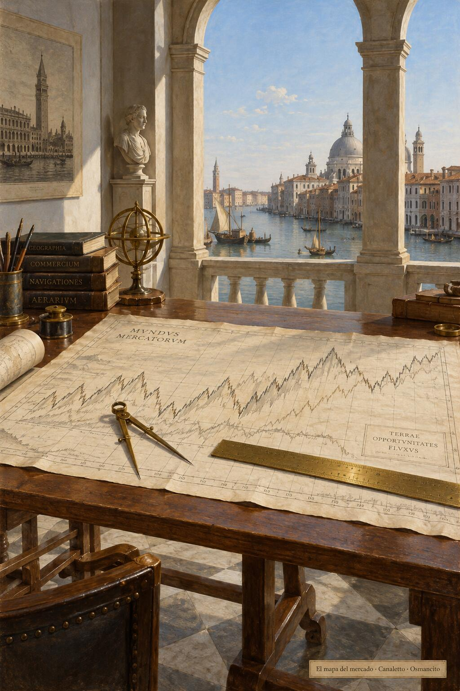
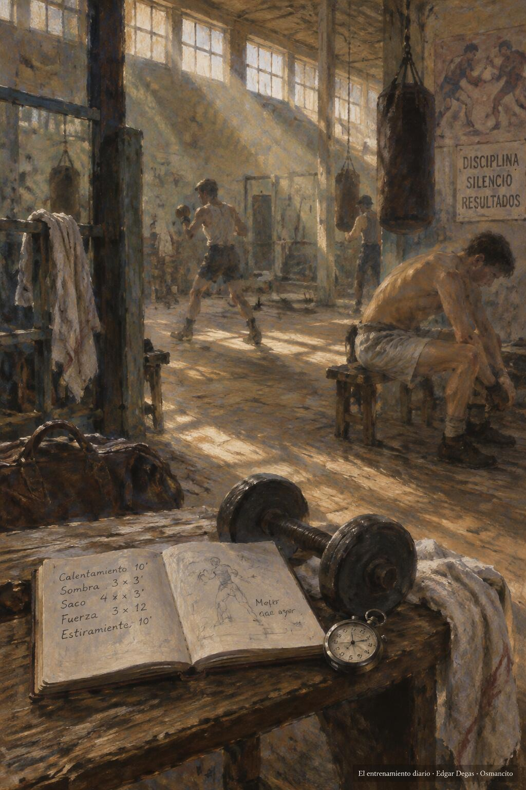
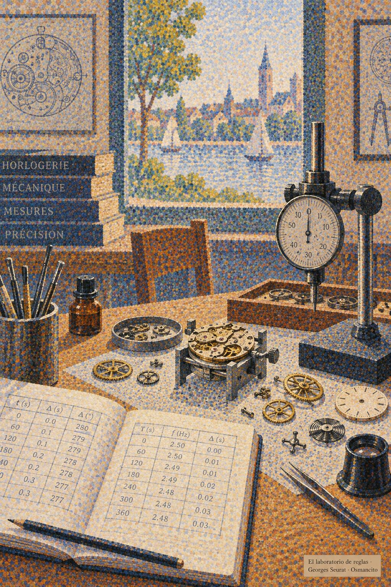
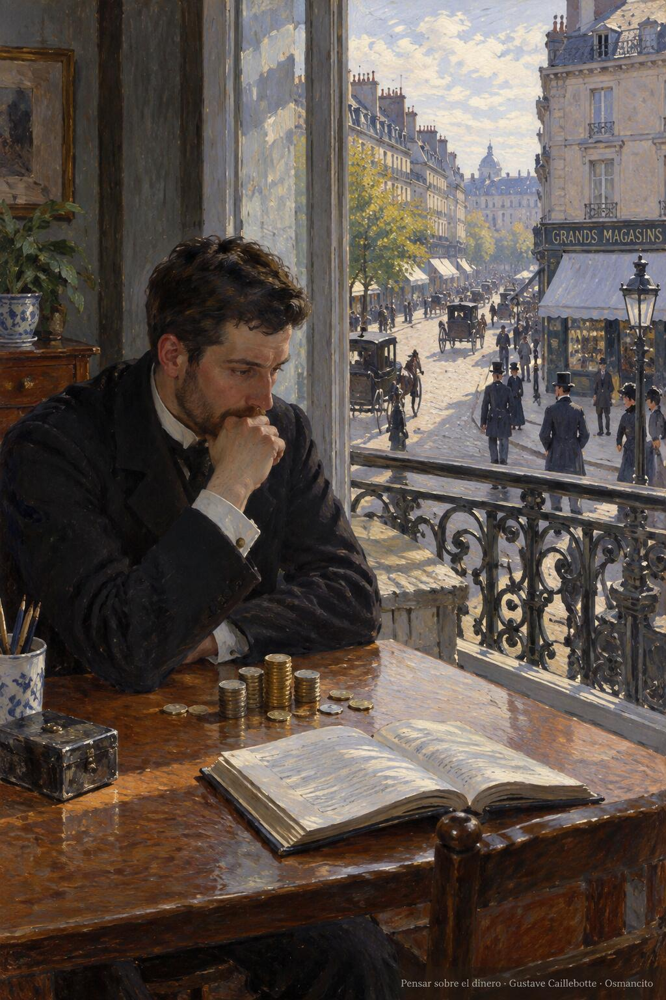

31 de octubre de 2026

# Los ocho maestros del trading

---

## ¿Qué es el trading?

El *trading* es comprar y vender activos, como acciones, divisas, materias primas o contratos. La palabra es inglesa: *trade* significa comercio o compraventa, y *trading* nombra la actividad. Quien la realiza es un *trader*, es decir, un operador.

Quien opera compra lo que otros necesitan vender y vende lo que otros necesitan comprar. Su actividad permite que esas personas encuentren con quién realizar el intercambio.

Esa actividad cumple funciones que la economía necesita. La compraventa constante fija los precios de los activos según su oferta y su demanda, y esos precios orientan las decisiones de empresas, gobiernos y familias. Quienes operan también contribuyen, en conjunto, a la liquidez: la facilidad para comprar y vender un activo y, cuando hace falta, convertirlo en dinero. Así ayudan a que los mercados funcionen con fluidez.

---

## ¿Qué son los mercados financieros?

Los mercados financieros son espacios donde se compran y venden, entre otras cosas, acciones y bonos. Comprar una acción significa adquirir una pequeña participación en una empresa. Comprar un bono significa prestarle dinero a quien lo emite, por ejemplo, una empresa o un gobierno.

---

## ¿Por qué es importante el trading?

El trading es importante porque contribuye a conectar dos necesidades: la de quien necesita vender y la de quien necesita comprar. Que ambas existan no basta para que se encuentren. Al ofrecer una contraparte, quienes operan pueden hacer posible un intercambio que de otro modo tendría que esperar.

Un ejemplo es el creador de mercado, un operador especializado en ofrecer compra y venta de forma continua. Compra antes de que llegue el siguiente comprador y asume ese intervalo con su dinero y su riesgo. Así permite que las personas actúen en momentos distintos sin que el intercambio se detenga. Ese servicio aporta liquidez al mercado.

Su importancia para la vida está ahí: facilitar que alguien disponga de recursos para continuar con lo que necesita hacer. El valor del servicio está en lograr conectar las dos necesidades. La ganancia del operador es un resultado posible; la utilidad para los demás es la razón que da sentido al oficio.

---

## ¿Qué se requiere para hacer trading?

Para hacer trading hace falta comprender los mercados financieros y saber desenvolverse en ellos. Saber qué comprar y qué vender es el comienzo. También hay que aprender a interpretar los precios, administrar el capital y mantener una forma de trabajar cuando los resultados son inciertos.

Estas exigencias tienen una dimensión técnica y otra humana: importan tanto los conocimientos como la conducta de quien los aplica.

Para aprender lo que el oficio exige, lo mejor que ofrece su literatura son los maestros que lo han enseñado con más profundidad. Esta entrada reúne mi selección de los ocho principales referentes para aprender trading: Alexander Elder, John J. Murphy, Van K. Tharp, Brett N. Steenbarger, Robert Carver, Jack D. Schwager, Mark Douglas y Morgan Housel. Cada uno entra por una razón propia, que su reseña explica, y aparecen en el orden en que los elegí.

---

## Alexander Elder

*El método completo*

Alexander Elder nació en Leningrado y creció en Estonia, donde entró a la facultad de medicina a los dieciséis años. A los veintitrés, trabajando como médico de un barco soviético, desertó en África y recibió asilo político en Estados Unidos. Ejerció como psiquiatra en Nueva York, enseñó en la Universidad de Columbia y en 1988 fundó su propia empresa de formación para traders. Sigue operando y dirige los Traders' Camps, sus campamentos intensivos.

Su obra junta en un solo método lo que otros tratan por separado: la psicología del trader y de la masa, el análisis del mercado y la gestión del dinero. De su oficio de psiquiatra sale su lectura de la euforia, el ego y la impaciencia que arruinan cuentas. Su consejo al principiante es no buscar ganar dinero sino aprender a operar bien: en su enfoque, la ganancia, cuando llega, es consecuencia de operar bien, no una meta que se persiga a lo directo. Al capital lo compara con el aire del buzo: quien lo malgasta no vuelve a la superficie.

Va primero como referencia general del oficio: reúne psicología, método y gestión del dinero en una enseñanza integrada, y su libro principal es lectura del programa de la Federación Internacional de Analistas Técnicos.

Obras:

- *Trading for a Living* (1993, *Vivir del trading*), donde junta psicología, método y gestión del dinero.
- *Come Into My Trading Room* (2002), la continuación, centrada en la práctica.
- *Entries & Exits* (2006), con operaciones reales explicadas una a una.
- *The New Trading for a Living* (2014), la actualización de su clásico.

---

## John J. Murphy

*El mapa del mercado*

John J. Murphy (1942-2026) fue la gran referencia del análisis técnico, la disciplina que lee los gráficos de precios, sus tendencias, patrones e indicadores, para entender hacia dónde se mueve un mercado. Trabajó en Merrill Lynch, donde llegó a dirigir el análisis técnico del departamento de materias primas, y después fue consultor independiente y profesor del New York Institute of Finance. Fue analista de CNBC durante siete años y analista técnico jefe de StockCharts.com. La Federación Internacional de Analistas Técnicos le dio su premio en 1992 y la Market Technicians Association el suyo en 2002. Murió el 7 de febrero de 2026.

Su libro principal, publicado en 1986 y ampliado en 1999, es la referencia estándar de la materia y texto de estudio de las certificaciones profesionales. También impulsó el análisis intermercado, que estudia cómo se influyen entre sí las acciones, los bonos, las materias primas y las divisas.

Ocupa el segundo lugar por ese mérito propio: es la referencia especializada para profundizar en los gráficos y el análisis técnico, con la claridad para explicar temas complejos que lo hizo lectura del programa de la Federación Internacional de Analistas Técnicos.

Obras:

- *Technical Analysis of the Futures Markets* (1986), ampliado como *Technical Analysis of the Financial Markets* (1999, *Análisis técnico de los mercados financieros*), su manual de referencia.
- *Intermarket Analysis* (2004), sobre cómo se influyen entre sí los mercados.
- *The Visual Investor* (1996), su método llevado a la lectura práctica de los gráficos.

---

## Van K. Tharp

*El sistema y el riesgo*

Van K. Tharp era doctor en psicología por el Centro de Ciencias de la Salud de la Universidad de Oklahoma, donde se graduó en 1975. Desde 1982 se dedicó a entrenar traders, apoyado en la programación neurolingüística, un enfoque que propone modelar las pautas de pensamiento y conducta de las personas destacadas, y fundó el Van Tharp Institute, su escuela de formación. Murió en febrero de 2022.

Su enfoque no enseña a buscar señales de entrada sino a construir un sistema completo, ajustado a la persona que lo va a usar: objetivos, entradas y salidas, expectativa matemática —cuánto se espera ganar o perder por operación en promedio— y riesgo asumido. Su idea central: el éxito no depende de predecir el mercado sino de gestionar el riesgo, y ahí la pieza clave es el tamaño de la posición, es decir, cuánto del activo se compra o se vende en cada operación, que junto con el precio de salida y los costes determina cuánto se puede perder. Con ese tamaño bien elegido, sostiene Tharp, se reduce el riesgo de que una mala racha agote el capital, aunque ese riesgo nunca desaparece del todo.

Ocupa el tercer lugar por el diseño de sistemas y la gestión del capital: con la visión general de Elder y el análisis técnico de Murphy ya presentados, Tharp los convierte en un sistema propio que aguante el paso del tiempo.

Obras:

- *Trade Your Way to Financial Freedom* (1998, segunda edición en 2006; traducción libre: «Opera a tu manera hacia la libertad financiera»), su manual de diseño de sistemas, de los objetivos al tamaño de posición.
- *Super Trader*, su programa de formación convertido en libro.
- *The Definitive Guide to Position Sizing*, dedicado por entero al tamaño de la posición.

---

## Brett N. Steenbarger

*El entrenamiento diario*

Brett N. Steenbarger es psicólogo clínico y profesor de psiquiatría y ciencias de la conducta en la Universidad Estatal de Nueva York, con más de cincuenta artículos científicos publicados. Además opera en los mercados por cuenta propia y construye sus propios modelos estadísticos, de modo que escribe desde los dos lados: el consultorio y la pantalla.

Su propuesta convierte el trabajo psicológico en entrenamiento concreto: llevar un diario, fijar metas, reconocer los patrones propios que se repiten, aplicar técnicas cognitivas y conductuales —maneras de trabajar sobre los pensamientos y los hábitos— y revisar el desempeño. El objetivo no es entenderse una sola vez sino practicar cada día: detectar errores recurrentes, practicar cambios y evaluar el progreso.

Ocupa el cuarto lugar por convertir la psicología del trading en un entrenamiento diario, medible y propio: no lecciones sobre la mente, sino ejercicios para la mente.

Obras:

- *The Psychology of Trading* (2003), herramientas y técnicas para trabajar la mente ante los mercados.
- *Enhancing Trader Performance* (2006), el desarrollo del trader como proceso de entrenamiento.
- *The Daily Trading Coach* (2009), 101 lecciones breves para ser cada día el propio entrenador.
- *Trading Psychology 2.0* (2015), de las mejores prácticas a los mejores procesos.

---

## Robert Carver

*El laboratorio de reglas*

Robert Carver es un operador e investigador británico. Trabajó durante años como gestor en uno de los mayores fondos de cobertura sistemáticos del mundo —los que operan siguiendo reglas fijas en lugar de decisiones del momento— y hoy opera por cuenta propia y explica su método en un sitio público.

Su terreno es la construcción y la prueba de estrategias sistemáticas: datos históricos, ajuste de parámetros, costes, tamaño de posición y combinación de estrategias. Su defensa de las reglas viene con una advertencia: probar estrategias con datos históricos y ajustar matemáticamente cuánto poner en cada inversión son herramientas poderosas pero potencialmente peligrosas, porque un resultado atractivo puede deberse a haber ajustado demasiado las reglas a los datos del pasado.

Ocupa el quinto lugar por darle a la selección su pieza más rigurosa: la estrategia sistemática puesta a prueba, con sus trampas incluidas.

Obras:

- *Leveraged Trading* (2019), la puerta de entrada: operar con apalancamiento —dinero prestado que multiplica ganancias y pérdidas— con estrategias semiautomáticas y sistemáticas.
- *Advanced Futures Trading Strategies* (2023), con más de treinta estrategias sistemáticas para futuros.
- *Smart Portfolios* (2017), la versión para invertir sin apalancamiento con reglas sistemáticas.
- *Systematic Trading* (2015), el libro avanzado: diseñar estrategias sistemáticas desde cero.

---

## Jack D. Schwager

*El espejo de los maestros*

Jack D. Schwager, economista formado en el Brooklyn College y en la Universidad Brown, pasó veintidós años como director de investigación de futuros en firmas de Wall Street y también fue gestor y asesor de fondos. Fundó FundSeeder, una plataforma que descubre traders desconocidos con resultados demostrables y los conecta con capital.

Su aporte son las entrevistas: desde 1989 ha preguntado en profundidad a los traders más exitosos del mundo cómo piensan, cómo operan y cómo sobrevivieron a sus peores pérdidas. Lo que muestran sus libros es que no existe un secreto único: los grandes comparten disciplina, gestión del riesgo y la capacidad de levantarse de caídas devastadoras.

Ocupa el sexto lugar por abrir la pluralidad de experiencias: sus entrevistas con operadores de enfoques distintos permiten contrastar lo que enseñan los manuales con decisiones, errores y trayectorias reales.

Obras, la serie *Market Wizards*:

- *Market Wizards* (1989, *Los magos del mercado*).
- *The New Market Wizards* (1992).
- *Stock Market Wizards* (2001).
- *Hedge Fund Market Wizards* (2012).
- *Unknown Market Wizards* (2020).
- Además, la referencia técnica *A Complete Guide to the Futures Markets* (1984), un manual exhaustivo de los mercados de futuros.

---

## Mark Douglas

*La mente en probabilidades*

Mark Douglas empezó como corredor de futuros en Chicago en 1981; los futuros son contratos que pactan hoy la compra o la venta de un activo a un precio fijado, para una fecha futura, y a menudo se liquidan en dinero, sin entregar el activo. Un año después comenzó a entrenar a otros traders, convirtiéndose, según su obituario, en el primer entrenador especializado en la psicología del trading. Trabajó con operadores de todo el mundo y con bancos y firmas de inversión. Falleció en septiembre de 2015, en su casa de Scottsdale, tres días después de terminar su tercer libro.

Su tesis: la mayoría de los traders fracasa no por falta de método sino por falta de la mentalidad para ejecutarlo. En su marco, el mercado es incierto y el resultado de cada operación se trata como aleatorio e independiente de la anterior; aceptarlo de verdad, y no solo entenderlo, es lo que él llama estar en la zona. Desde esa posición, el trader deja de necesitar tener razón en cada operación y se limita a seguir su plan.

Ocupa el séptimo lugar como complemento del entrenamiento práctico de Steenbarger: explica cómo la necesidad de acertar y la resistencia a perder interfieren en la ejecución, y enseña la aceptación de la incertidumbre.

Obras:

- *The Disciplined Trader* (1990), de los primeros libros en llevar la psicología del trading a la industria.
- *Trading in the Zone* (2001, *Trading en la zona*).

---

## Morgan Housel

*Cómo pensamos sobre el dinero*

Morgan Housel es escritor de finanzas. Se graduó de la universidad en 2008, justo cuando estallaba la crisis financiera, y en lugar de entrar a la banca terminó escribiendo: pasó casi diez años en The Motley Fool, una empresa de análisis y consejos de inversión, y fue columnista del Wall Street Journal. Hoy es socio de Collaborative Fund, una firma de inversión, y forma parte del consejo de la aseguradora Markel. Ha ganado dos veces el premio Best in Business del periodismo económico estadounidense.

Su tema no son los números sino la conducta: por qué personas inteligentes toman malas decisiones con el dinero, qué papel tienen la suerte y el riesgo, y por qué las decisiones financieras no se toman en una hoja de cálculo sino en la mesa de la casa, con la historia, el orgullo y los miedos de cada uno mezclados en ellas. Su libro más conocido reúne esas ideas en diecinueve relatos breves y ha vendido más de diez millones de ejemplares.

Cierra la selección con la pregunta que pone todo lo demás en su sitio: para qué queremos el dinero y cuánto es suficiente. Su tema son la conducta, las expectativas y la relación personal con el dinero: poner la actividad del trading al servicio de la vida.

Obras:

- *The Psychology of Money* (2020, *La psicología del dinero*).
- *Same as Ever* (2023, *Lo que nunca cambia*).
- *The Art of Spending Money*, su libro más reciente.

## Fuentes

- [Wikipedia](https://es.wikipedia.org/wiki/Mercado_financiero): funciones de los mercados financieros.
- [IFTA](https://www.ifta.org/assets/docs/IFTA_CFTe_Syllabus_Reading_Material.pdf): lecturas del programa de la Federación Internacional de Analistas Técnicos, con los manuales de Murphy y Elder.
- [Investopedia](https://www.investopedia.com/articles/personal-finance/090916/top-5-books-learn-technical-analysis.asp): John Murphy entre los libros para aprender análisis técnico.
- [Wiley](https://www.wiley.com/en-us/The+New+Trading+for+a+Living%3A+Psychology%2C+Discipline%2C+Trading+Tools+and+Systems%2C+Risk+Control%2C+Trade+Management-p-9781118443927): biografía de Alexander Elder.
- [Wiley](https://www.wiley.com/en-us/The+Psychology+of+Trading%3A+Tools+and+Techniques+for+Minding+the+Markets-p-9780471267614): biografía de Brett N. Steenbarger.
- [Wiley](https://books.wiley.com/series/wiley_trading/trading_psychology/): la serie de psicología del trading de Steenbarger, con años de publicación.
- [Systematic Money](https://www.systematicmoney.org/systematic-trading-information): Robert Carver sobre el trading sistemático y sus riesgos.
- [Systematic Money](https://www.systematicmoney.org/which-book-should-i-buy): los libros de Carver descritos por él mismo.
- [Harriman House](https://www.harriman-house.com/authors/robert-carver/advanced-futures-trading-strategies/9780857199683): *Advanced Futures Trading Strategies*.
- [Harriman House](https://www.harriman-house.com/authors/morgan-housel/the-psychology-of-money/9780857197689): *The Psychology of Money*, de Morgan Housel.
- [Penguin Random House](https://www.penguinrandomhouse.com/authors/240181/mark-douglas/): nota de autor de Mark Douglas.
- [Van Tharp Institute](https://vantharpinstitute.com/about-van-tharp/): sobre Van K. Tharp.
- [Wikipedia](https://en.wikipedia.org/wiki/John_Murphy_(technical_analyst)): John Murphy, trayectoria y obras.
- [Wikipedia](https://en.wikipedia.org/wiki/Jack_D._Schwager): Jack D. Schwager.
- [Society of Technical Analysts](https://www.technicalanalysts.com/Public/Web/News/JohnMurphy.aspx): nota sobre John Murphy.
- [Chicago Tribune, vía Legacy](https://www.legacy.com/us/obituaries/chicagotribune/name/mark-douglas-obituary?pid=181231049): obituario de Mark Douglas.
- [Yahoo Finance](https://finance.yahoo.com/news/reflecting-depth-mark-douglas-taught-114851970.html): nota del 16 de septiembre de 2015 sobre su muerte.
- [FundSeeder](https://www.fundseeder.com/about): la plataforma fundada por Jack Schwager.

© 2026 Osmancito
