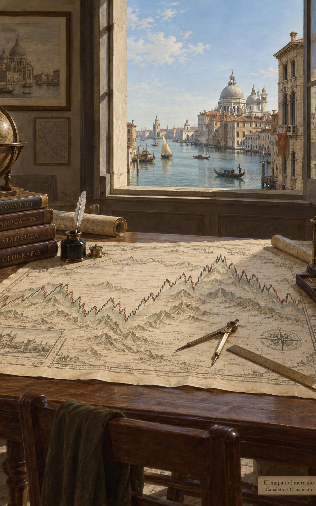

31 de octubre de 2026

# Los seis maestros de la molienda

La Molienda es un recorrido de aprendizaje: aprender a operar en los mercados desde cero, caminando en público y dejando el camino escrito para quien venga detrás.

El nombre pone una imagen sobre ese trabajo: la molienda, la labor constante que saca provecho de una materia dura. En este recorrido ese provecho es el dinero.

El dinero se puede buscar de muchas maneras; este camino lo busca en los mercados. Operar en los mercados, lo que en inglés se llama *trading*, es comprar y vender activos, como acciones, divisas, materias primas o contratos, buscando ganar con los cambios de su precio.

Los maestros del recorrido son seis, y se leerán en este orden: Morgan Housel, John J. Murphy, Alexander Elder, Van K. Tharp, Mark Douglas y Jack D. Schwager. Cada uno tiene su sección más abajo, con su historia, sus ideas y sus obras.

## Morgan Housel: cómo pensamos sobre el dinero

Morgan Housel es escritor de finanzas. Se graduó de la universidad en 2008, justo cuando estallaba la crisis financiera, y en lugar de entrar a la banca terminó escribiendo: pasó casi diez años en The Motley Fool, una empresa de análisis y consejos de inversión, y fue columnista del Wall Street Journal. Hoy es socio de Collaborative Fund, una firma de inversión, y forma parte del consejo de la aseguradora Markel. Ha ganado dos veces el premio Best in Business del periodismo económico estadounidense.

Su tema no son los números sino la conducta: por qué personas inteligentes toman malas decisiones con el dinero, qué papel tienen la suerte y el riesgo, y por qué las decisiones financieras no se toman en una hoja de cálculo sino en la mesa de la casa, con la historia, el orgullo y los miedos de cada uno mezclados en ellas. Su libro más conocido reúne esas ideas en diecinueve relatos breves y ha vendido más de diez millones de ejemplares.

Abre el camino porque la primera idea del recorrido no es técnica: antes de leer un solo gráfico conviene saber en qué terreno mental se pisa. La resume el editor de *The Psychology of Money* en la presentación del libro: ir bien con el dinero no depende tanto de lo que se sabe como de cómo uno se comporta.

Obras:

- *The Psychology of Money* (2020; en castellano, *La psicología del dinero*).
- *Same as Ever* (2023; en castellano, *Lo que nunca cambia*).
- *The Art of Spending Money*, su libro más reciente.

## John J. Murphy: el mapa del mercado

John J. Murphy (1942-2026) fue la gran referencia del análisis técnico, la disciplina que lee los gráficos de precios, sus tendencias, patrones e indicadores, para entender hacia dónde se mueve un mercado. Trabajó en Merrill Lynch, donde llegó a dirigir el análisis técnico del departamento de materias primas, y después fue consultor independiente y profesor del New York Institute of Finance. Fue analista de CNBC durante siete años y analista técnico jefe de StockCharts.com. La Federación Internacional de Analistas Técnicos le dio su premio en 1992 y la Market Technicians Association el suyo en 2002. Murió el 7 de febrero de 2026.

Su libro principal, publicado en 1986 y ampliado en 1999, es la referencia estándar de la materia y texto de estudio de las certificaciones profesionales. También impulsó el análisis intermercado, que estudia cómo se influyen entre sí las acciones, los bonos, las materias primas y las divisas.

En este recorrido, Murphy entrega el mapa del terreno: el lenguaje de los gráficos con que se leerán los pasos siguientes.

Obras:

- *Technical Analysis of the Futures Markets* (1986), ampliado como *Technical Analysis of the Financial Markets* (1999; en castellano, *Análisis técnico de los mercados financieros*).
- *Intermarket Analysis* (2004).
- *The Visual Investor* (1996).

## Alexander Elder: el método completo

Alexander Elder nació en Leningrado y creció en Estonia, donde entró a la facultad de medicina a los dieciséis años. A los veintitrés, trabajando como médico de un barco soviético, desertó en África y recibió asilo político en Estados Unidos. Ejerció como psiquiatra en Nueva York, enseñó en la Universidad de Columbia y en 1988 fundó su propia empresa de formación para traders. Sigue operando y dirige los Traders' Camps, sus campamentos intensivos.

Su obra junta en un solo método lo que otros tratan por separado: la psicología del trader y de la masa, el análisis del mercado y la gestión del dinero. De su oficio de psiquiatra sale su lectura de la euforia, el ego y la impaciencia que arruinan cuentas. Su consejo al principiante es no buscar ganar dinero sino aprender a operar bien: en su enfoque, la ganancia, cuando llega, es consecuencia de operar bien, no una meta que se persiga a lo directo. Al capital lo compara con el aire del buzo: quien lo malgasta no vuelve a la superficie.

Es el centro del recorrido: con la mentalidad y el mapa ya vistos, Elder muestra el oficio entero, como una profesión disciplinada.

Obras:

- *Trading for a Living* (1993; en castellano, *Vivir del trading*).
- *Come Into My Trading Room* (2002).
- *Entries & Exits* (2006), con operaciones reales explicadas una a una.
- *The New Trading for a Living* (2014), la actualización de su clásico.

## Van K. Tharp: el sistema y el riesgo

Van K. Tharp era doctor en psicología por el Centro de Ciencias de la Salud de la Universidad de Oklahoma, donde se graduó en 1975. Desde 1982 se dedicó a entrenar traders, apoyado en la programación neurolingüística, un enfoque que propone modelar las pautas de pensamiento y conducta de las personas destacadas, y fundó el Van Tharp Institute, su escuela de formación. Murió en febrero de 2022.

Su enfoque no enseña a buscar señales de entrada sino a construir un sistema completo, ajustado a la persona que lo va a usar. Su idea central: el éxito no depende de predecir el mercado sino de gestionar el riesgo, y ahí la pieza clave es el tamaño de la posición, es decir, cuánto del activo se compra o se vende en cada operación, que junto con el precio de salida y los costes determina cuánto se puede perder. Con ese tamaño bien elegido, sostiene Tharp, se reduce el riesgo de que una mala racha agote el capital, aunque ese riesgo nunca desaparece del todo.

Tharp llega cuando ya hay mapa y método, para convertirlos en un sistema propio que aguante el paso del tiempo.

Obras:

- *Trade Your Way to Financial Freedom* (1998; traducción libre: «Opera a tu manera hacia la libertad financiera»).
- *Super Trader*, su programa de formación convertido en libro.

## Mark Douglas: la mente en probabilidades

Mark Douglas empezó como corredor de futuros en Chicago en 1981; los futuros son contratos que pactan hoy la compra o la venta de un activo a un precio fijado, para una fecha futura, y a menudo se liquidan en dinero, sin entregar el activo. Un año después comenzó a entrenar a otros traders, convirtiéndose, según su obituario, en el primer entrenador especializado en la psicología del trading. Trabajó con operadores de todo el mundo y con bancos y firmas de inversión. Falleció en septiembre de 2015, en su casa de Scottsdale, tres días después de terminar su tercer libro.

Su tesis: la mayoría de los traders fracasa no por falta de método sino por falta de la mentalidad para ejecutarlo. En su marco, el mercado es incierto y el resultado de cada operación se trata como aleatorio e independiente de la anterior; aceptarlo de verdad, y no solo entenderlo, es lo que él llama estar en la zona. Desde esa posición, el trader deja de necesitar tener razón en cada operación y se limita a seguir su plan.

Se lee con el sistema ya armado: Douglas no enseña qué hacer, prepara la mente para hacerlo una y otra vez.

Obras:

- *The Disciplined Trader* (1990), de los primeros libros en llevar la psicología del trading a la industria.
- *Trading in the Zone* (2001; en castellano, *Trading en la zona*).

## Jack D. Schwager: el espejo de los maestros

Jack D. Schwager, economista formado en el Brooklyn College y en la Universidad Brown, pasó veintidós años como director de investigación de futuros en firmas de Wall Street y también fue gestor y asesor de fondos. Fundó FundSeeder, una plataforma que descubre traders desconocidos con resultados demostrables y los conecta con capital.

Su aporte son las entrevistas: desde 1989 ha preguntado en profundidad a los traders más exitosos del mundo cómo piensan, cómo operan y cómo sobrevivieron a sus peores pérdidas. Lo que muestran sus libros es que no existe un secreto único: los grandes comparten disciplina, gestión del riesgo y la capacidad de levantarse de caídas devastadoras.

Cierra el recorrido como un espejo: después de la mentalidad, el mapa, el método, el sistema y la zona, sus entrevistados muestran cómo otros aplicaron, o no, esos mismos principios.

Obras, la serie *Market Wizards*:

- *Market Wizards* (1989; en castellano, *Los magos del mercado*).
- *The New Market Wizards* (1992).
- *Stock Market Wizards* (2001).
- *Hedge Fund Market Wizards* (2012).
- *Unknown Market Wizards* (2020).
- Además, la referencia técnica *A Complete Guide to the Futures Markets* (1984).

## La hoja de ruta

El recorrido se camina en el orden en que se presentaron los maestros, y cada etapa deja algo concreto:

1. La mentalidad del dinero, con Housel: entender cómo pensamos y nos comportamos con el dinero antes de tocar el mercado.
2. El mapa del mercado, con Murphy: aprender a leer los gráficos y las relaciones entre mercados.
3. El método completo, con Elder: unir psicología, análisis y gestión del dinero en una práctica disciplinada.
4. El sistema y el riesgo, con Tharp: diseñar un sistema propio y gestionar el riesgo de las malas rachas.
5. La mente en la zona, con Douglas: ejecutar pensando en probabilidades.
6. El espejo de los maestros, con Schwager: ver esos principios vivos en quienes ya lo lograron.

Cada etapa irá dejando sus entradas aquí, en la Tesorería, a medida que el camino avance.

## Fuentes

- [Wiley](https://www.wiley.com/en-us/The+New+Trading+for+a+Living%3A+Psychology%2C+Discipline%2C+Trading+Tools+and+Systems%2C+Risk+Control%2C+Trade+Management-p-9781118443927): biografía de Alexander Elder.
- [Penguin Random House](https://www.penguinrandomhouse.com/authors/240181/mark-douglas/): nota de autor de Mark Douglas.
- [Harriman House](https://www.harriman-house.com/authors/morgan-housel/the-psychology-of-money/9780857197689): *The Psychology of Money*, de Morgan Housel.
- [Van Tharp Institute](https://vantharpinstitute.com/about-van-tharp/): sobre Van K. Tharp.
- [Wikipedia](https://en.wikipedia.org/wiki/John_Murphy_(technical_analyst)): John Murphy, trayectoria y obras.
- [Wikipedia](https://en.wikipedia.org/wiki/Jack_D._Schwager): Jack D. Schwager.
- [Society of Technical Analysts](https://www.technicalanalysts.com/Public/Web/News/JohnMurphy.aspx): nota sobre John Murphy.
- [Chicago Tribune, vía Legacy](https://www.legacy.com/us/obituaries/chicagotribune/name/mark-douglas-obituary?pid=181231049): obituario de Mark Douglas.
- [Yahoo Finance](https://finance.yahoo.com/news/reflecting-depth-mark-douglas-taught-114851970.html): nota del 16 de septiembre de 2015 sobre su muerte.
- [FundSeeder](https://www.fundseeder.com/about): la plataforma fundada por Jack Schwager.

© 2026 Osmancito
