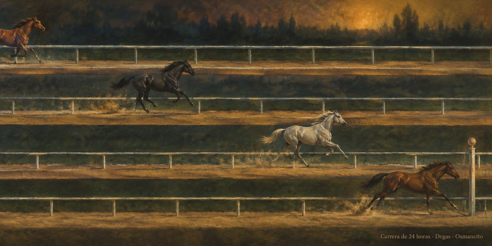

# Visual horse

10 de noviembre de 2026

Carrera según el mínimo y el máximo de las últimas 24 horas.

[Abrir el visualizador](../html/261110_visual-horse.html)

**Visual horse** es un visualizador: una página que muestra activos como caballos en carriles paralelos. Un **activo** es un producto que se compra y se vende en un mercado. Cada carril es la franja de precio de un activo en las últimas 24 horas: a la izquierda queda el mínimo, a la derecha el máximo, y el caballo marca dónde está el precio ahora dentro de esa franja. La página consulta los datos de CoinGecko directamente desde el navegador y los renueva cada minuto.

Los precios se abrevian con la convención de Interloper: `k` para miles, `u` para unidades y `m` para milésimas (`318.0 m` es 0,3180). Las monedas estables, las que imitan al dólar, quedan fuera: su franja de 24 horas es de centésimas de céntimo, y en esa escala su posición no dice nada del mercado.

La posición dentro de la franja no es ganancia ni pérdida. Esta página informa; no recomienda comprar ni vender.

© 2026 Osmancito
