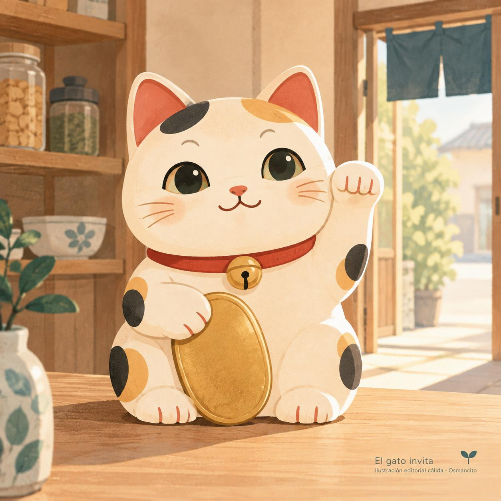

13 de noviembre de 2026

# Maneki-neko

Un gato pequeño espera junto a la caja de una tienda. Tiene una pata levantada y, a menudo, una moneda dorada contra el vientre. Es el *maneki-neko*, la figura japonesa que invita a la buena fortuna y a los clientes a entrar. Su nombre reúne *maneku*, «invitar», y *neko*, «gato». La patita no se despide: llama.

## Una invitación al negocio

La distinción más extendida atribuye a la pata izquierda el poder de atraer personas, de ahí su presencia en los comercios; a la derecha, el de atraer riqueza y buena suerte. Son significados de una tradición, no instrucciones que todos los fabricantes sigan de la misma manera. Los colores también hablan: el dorado alude al dinero; el negro se asocia con la protección contra el mal. El blanco, con manchas negras y anaranjadas, conserva la apariencia del gato tricolor.

Aunque aparezca en restaurantes y tiendas de distintas partes del mundo, el *maneki-neko* es de origen japonés. Muchos ejemplares llevan un collar, un cascabel o un babero decorado. Otros sujetan una moneda ovalada: la fortuna toma una forma que cabe entre dos patas.

## Entre la leyenda y el barro

No se conoce un origen único y seguro. Una de las leyendas lo sitúa en Gōtokuji, un templo de Tokio. Cuenta que un gato hizo señas a un señor que pasaba por allí. El hombre entró, quedó a salvo de una tormenta y, agradecido, ayudó al templo con sus donaciones. El gato habría traído prosperidad al lugar con una invitación.

Otra historia habla de una anciana de Imado, también en Tokio, que tuvo que separarse de su gato porque no podía alimentarlo. El animal se le apareció en sueños y le aconsejó hacer figuras con su imagen. La mujer las vendió y salió de la pobreza. En una leyenda, el gato consigue un benefactor; en la otra, da origen a un pequeño negocio.

Las figuras de barro ofrecen un rastro más firme que los relatos. Los primeros *maneki-neko* se sitúan hacia mediados del siglo XIX. Con el tiempo, distintos centros de cerámica desarrollaron sus versiones. Tokoname, una ciudad japonesa dedicada a esa producción, empezó a fabricarlos a finales de la década de 1930. Su gato característico tiene el cuerpo regordete, los ojos y las orejas grandes: una presencia amable hecha para llamar la atención.

## La fortuna tiene puerta

Antes de representar la prosperidad, los gatos prestaban un servicio concreto: cazaban ratones y otros animales que perjudicaban a agricultores y comerciantes. La figura conserva esa cercanía entre el gato y lo que se desea proteger.

En el mostrador, el *maneki-neko* convierte el deseo de que al negocio le vaya bien en una escena diminuta. Una moneda, una sonrisa y una pata alzada. La riqueza está en el vientre; la invitación mira hacia la puerta.

## Fuentes

- [Ministerio japonés de Tierra, Infraestructura, Transporte y Turismo: los gatos de Tokoname](https://www.mlit.go.jp/tagengo-db/common/001782356.pdf). Nombre, patas, origen incierto y producción de cerámica.
- [Japan Creative Centre, Embajada de Japón en Singapur: el gato de la suerte](https://www.sg.emb-japan.go.jp/JCC/E-Magazine-Jan-2023-Maneki-Neko.html). Leyendas de Gōtokuji e Imado y significados tradicionales.
- [SFO Museum: el gato japonés que invita](https://www.sfomuseum.org/exhibitions/maneki-neko-japans-beckoning-cat). Historia de las figuras, colores, adornos y difusión fuera de Japón.

© 2026 Osmancito

[Volver a Tesorería](../tesoreria.html)
