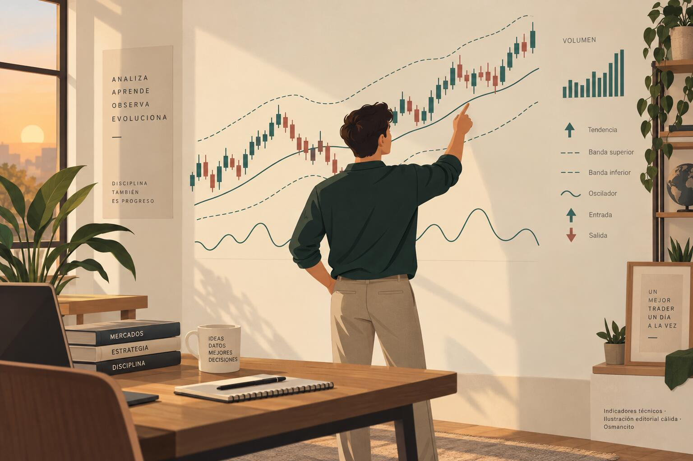

19 de noviembre de 2026

# Indicadores técnicos para gráficos

Un indicador técnico es un cálculo matemático sobre el precio o sobre el volumen de negociación de un activo, que se dibuja sobre su gráfica para ayudar a leer su comportamiento. Unos siguen la tendencia, otros miden la fuerza del movimiento, otros la volatilidad o el volumen.

## La lista

**0-9.** 52 Week High/Low.

**A.** Accelerator Oscillator, Accumulation/Distribution, Accumulative Swing Index, Advance/Decline, Arnaud Legoux Moving Average, Aroon, Average Directional Index, Average Price, Average True Range, Awesome Oscillator.

**B.** Balance of Power, Bollinger Bands, Bollinger Bands %B, Bollinger Bands Width.

**C.** Chaikin Money Flow, Chaikin Oscillator, Chaikin Volatility, Chande Kroll Stop, Chande Momentum Oscillator, Chop Zone, Choppiness Index, Commodity Channel Index, Connors RSI, Coppock Curve, Correlation Coefficient, Correlation - Log.

**D.** Detrended Price Oscillator, Directional Movement, Donchian Channels, Double EMA.

**E.** Ease of Movement, Elder's Force Index, EMA Cross, Envelopes.

**F.** Fisher Transform.

**G.** Guppy Multiple Moving Average.

**H.** Historical Volatility, Hull Moving Average.

**I.** Ichimoku Cloud.

**K.** Keltner Channels, Klinger Oscillator, Know Sure Thing.

**L.** Least Squares Moving Average, Linear Regression Curve, Linear Regression Slope.

**M.** MA Cross, MA with EMA Cross, Mass Index, McGinley Dynamic, Median Price, Momentum, Money Flow Index, Moving Average, Moving Average Channel, MACD, Moving Average Exponential, Moving Average Weighted, Moving Average Double, Moving Average Triple, Moving Average Adaptive, Moving Average Hamming, Moving Average Multiple, Majority Rule.

**N.** Net Volume.

**O.** On Balance Volume.

**P.** Parabolic SAR, Pivot Points Standard, Price Channel, Price Oscillator, Price Volume Trend.

**R.** Rank Correlation Index, Rate Of Change, Ratio, Relative Strength Index, Relative Vigor Index, Relative Volatility Index.

**S.** Standard Error, Standard Error Bands, SMI Ergodic Indicator/Oscillator, Smoothed Moving Average, Standard Deviation, Stochastic, Stochastic RSI, SuperTrend, Spread.

**T.** TRIX, Triple EMA, True Strength Indicator, Trend Strength Index, Typical Price.

**U.** Ultimate Oscillator.

**V.** Volatility Close-to-Close, Volatility Zero Trend Close-to-Close, Volatility O-H-L-C, Volatility Index, VWAP, VWMA, Volume Oscillator, Volume Profile Fixed Range, Volume Profile Visible Range, Vortex Indicator, Volume.

**W.** Williams %R, Williams Alligator, Williams Fractal.

**Z.** Zig Zag.

Fuente: [lista oficial de indicadores de la biblioteca de gráficos de TradingView](https://www.tradingview.com/charting-library-docs/latest/ui_elements/indicators/Indicators-List/), consultada el 19 de noviembre de 2026.

© 2026 Osmancito

[Volver a Tesorería](../tesoreria.html)
